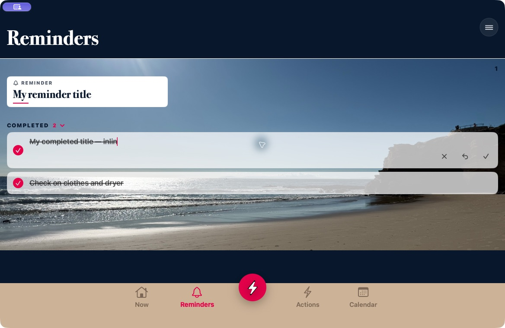
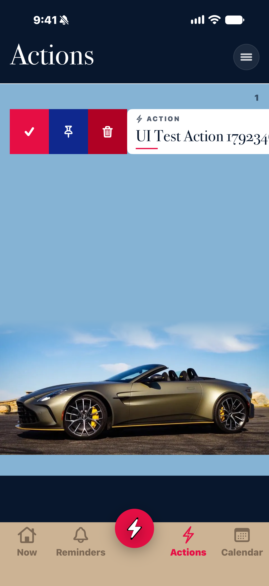
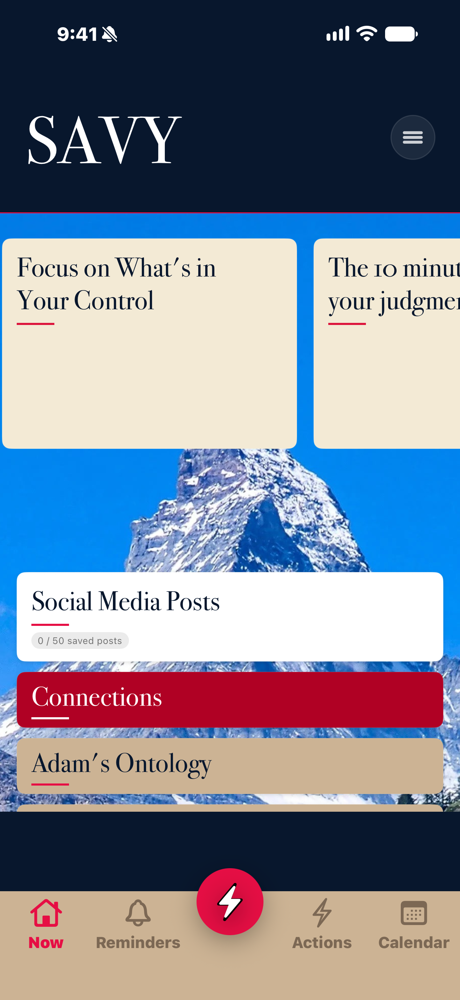

# Inline card titles

Adam's requirement: “when you press and hold, it should create a blinking cursor on the line of the card” and “There should be no freaking weird pop up”.

Holding a card puts the cursor at the end of its current title. The title stays inside the card and inherits its type, color, background, and spacing. Backspace edits the existing text immediately. Tapping outside the card saves the title and closes its keyboard; a separate Save press is not required. Taps inside the card keep editing. An empty draft keeps the previously saved title and still dismisses the editor. The card contains small Save, Cancel, and (after a rename) Restore Original controls. Cards that support reordering retain their move arrows there. Completed cards retain their Delete icon inside the card. On iPhone, the bottom navigation yields its space while a title is being edited. Navigation and swiping resume when editing finishes.

Adam also requested: “remove all labels from choices revealed when sliding card.” The shared swipe tray now shows only its checkmark, pin, and trash icons on both platforms. Accessible action names and the original hit targets remain available.

Coverage: Home destination cards and carousel, Reminders and Actions (including completed entries), Calendar, Connection, Social posts, Stories, source cards in Ontology/Field Essays/Social, and Personal Authority review cards.

Titles use the entry's stable identity, so the same entry has the same chosen title across pages. The original writing remains intact. Titles persist locally and merge individually through the existing CloudKit journal, in a separate `card-titles` document. UI checks use isolated stores and preferences.

## Verification

- Native Mac interaction: held and edited cards in the Home list/carousel, Reminders, completed rows, Actions, Calendar, Social, Stories, Connection, and source/review pages. Observed the inline field, end-position Backspace, Save, Cancel, and restored titles. The screenshot uses isolated sample data.
- Installed Mac Release: observed the inline cursor on the live Home card, then cancelled without changing its writing. Observed the icon-only swipe tray. All 13 original saved-payload hashes remained unchanged; no recovery drafts. The installed binary matches the Release product and passes strict signature verification.
- Physical iPhone: Home cards/carousel, source pages, Social, Connection, Stories, Calendar, and Reminders passed hold-to-edit, immediate end-position Backspace, Cancel, Save/reopen, Restore Original, and swipe checks. Action and completed-Action editing, Pin/Unpin, Done, and Delete passed the final targeted rerun. Home aliases survived app relaunch and still opened their original destinations.
- Physical iPhone final regression: Home and Actions moved within their pin groups, retained their order after relaunch, and kept normal navigation/scrolling. The normal app was then relaunched on the real collection; all 21 original payload/image hashes matched, with no recovery drafts.
- Two persistence/sync unit tests pass on Mac: exact text and stable identity across relaunch, untouched original data, empty-title rejection, independent offline edits, and reset propagation.

## Reproducible evidence

Device XCTest and Mac build logs are retained locally in `/tmp/savy-card-titles-20261018/`. All UI fixtures use the isolated `SAVYUITests` store and preferences; the included screenshots contain synthetic test entries.

- `phone-inline-final.xcresult`: seven passing page checks; its Action check exposed a completed-card accessibility grouping issue corrected in the later rerun.
- `phone-keyboard-final.xcresult`: passing source/relaunch and complete Action flows with the final keyboard-space behavior. Two old reorder checks selected the keyboard prediction strip as their first scroll view; the harness now selects the actual page and excludes the keyboard from its visible area.
- `phone-reorder-acceptance.xcresult`: both physical-iPhone order/pin/relaunch checks passed after selecting the page and accounting for the separate keyboard prediction strip. The diagnostic runs are retained alongside it.
- `phone-integrity-final.json`: all 21 original iPhone payloads/images unchanged; zero drafts.
- `mac-title-unit-final.xcresult`: two passing title persistence and journal-merge tests. This verifies local sync merging, not a synthetic write into the live iCloud account.
- `mac-final.log`: final signed Mac Release installation and launch.

## Tap outside to save

Adam: “When I tap outside the card, save the title and close the keyboard. I don't want to have to press a separate save button.”

The shared card editor observes outside taps in its own window while editing, preserving native card controls, scrolling, and keyboard input. Completed cards include their entire row padding in the inside area. The observer is removed when editing ends.

Native Mac checks used an isolated copy of the installed Release: an outside click saved and closed the carousel editor, its title appeared on the Actions page, and the completed card saved the same way. Clicking blank space inside the card kept editing. Swipe actions remained usable after finishing.

Physical-iPhone checks passed outside-tap saving on source cards, the Home carousel, Actions, completed Actions, and Calendar. Each reopened with the saved title; Cancel and Restore Original continued working. The Action and Calendar flows also retained their swipe and entry-form checks.

Follow-up evidence is retained in `/tmp/savy-title-outside-20261018/`: `phone-outside.xcresult` contains the passing source/carousel checks, and `phone-outside-recheck.xcresult` contains the passing Action and Calendar checks. Initial diagnostics are retained: narrow-margin test taps reached expanded navigation/disclosure targets, so the harness now uses an unoccupied header area; the software-keyboard fixture uses a real word to avoid testing an autocorrect substitution as a persistence failure.

`phone-outside-keyboard.xcresult` passes the dedicated interaction on the physical iPhone: an actual software-keyboard key changes the title, an inside tap retains editing, an outside tap saves and dismisses the keyboard, relaunch retains the exact saved title, and an empty draft dismisses while retaining the prior title. The normal phone app was relaunched on its existing collection afterward. All 21 original phone payload/image hashes and all 13 original Mac saved-payload hashes match their backups, with zero recovery drafts. The installed Mac binary matches the signed Release product.

