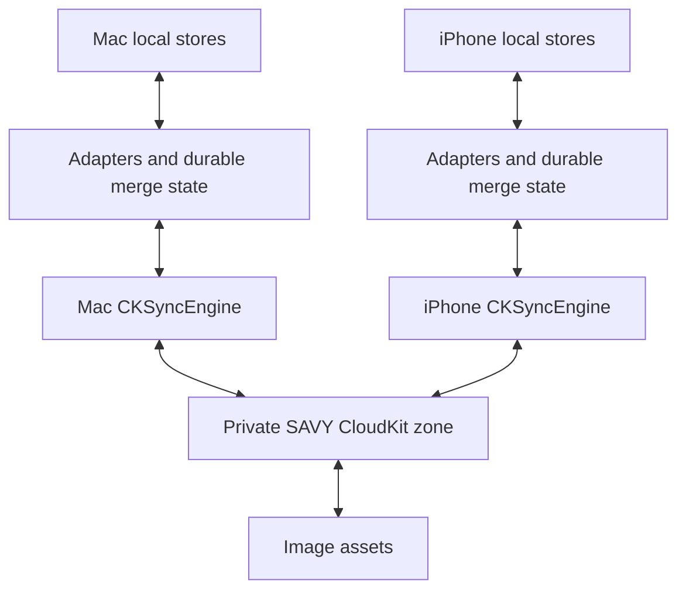
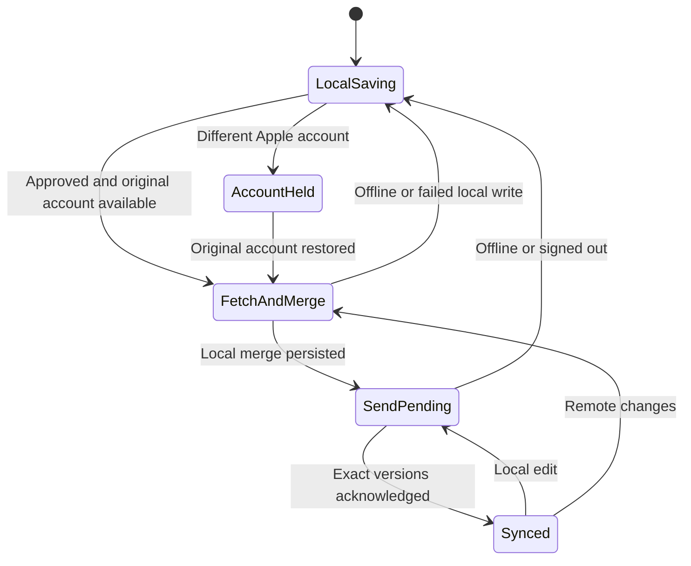

# SAVY iCloud Sync - Plan

Current step: build the sync foundation; activate iCloud after Adam approves this plan.

Local apps ✓ → Plan HERE → Merge foundation → CloudKit → Install both → Verify both

Next move: prove the merge and offline queue in isolated storage, then connect the two installed apps.

## Goal Capsule

- **Objective:** Adam sees the same SAVY entries on his Mac and iPhone after saving on either device.
- **Means:** Native CloudKit sync (KTD1).
- **Approval:** Adam requested: “Ok. Build a plan i can approve and let's begin implementing cloud sync”. Code and isolated verification begin now; uploading existing data and activating the installed apps follow approval.
- **Delivery:** Codex implements, signs, installs, and checks both devices. Adam approves the plan; he does not become the migration operator.

---

## Product Contract

### Summary

Use the Apple account already signed into each device to sync SAVY privately through iCloud. Keep the existing native app and immediate local saves. Merge the two existing collections before normal syncing starts.

### Problem Frame

AWS has been cancelled. SAVY now opens without a login, but the Mac and iPhone save independently. Their 42 reminder-based entries share IDs, and two records contain different writing with different update dates.

### Requirements

**Everyday use**

- R1. Entries created, edited, completed, pinned, reordered, or deleted on either device reach the other device.
- R2. Saving works immediately offline, and pending changes survive closing and reopening SAVY.
- R3. SAVY uses the system iCloud account and keeps opening without a separate SAVY login.
- R4. Sync includes reminder-based Actions, Reminders, Calendar entries and Posts; authored Connections; legacy social posts; Stories; attached images; card arrangements; post numbering; and the existing portable personal-authority decisions.

**Existing data and device behavior**

- R5. Initial import retains stable IDs and original dates, merges each record independently, and preserves both originals before resolving differing writing.
- R6. Native calendar identifiers, notification delivery, technical captures, candidate outboxes, and delegation files stay device-local; receiving a record does not create calendar invitations or recapture it as new user input.
- R7. A deletion propagates without an older offline copy recreating the entry.
- R8. An unreadable local file or failed write cannot become an empty cloud collection or an acknowledged successful merge.
- R9. Signing out of iCloud keeps local data usable; switching to another Apple account stops sync until the account boundary is resolved, and never silently uploads the previous account's data.
- R10. Completion requires the actual installed Mac app and connected iPhone to show the merged data; a build or empty queue alone is insufficient.

### Scope Boundaries

The accepted native screens and wording stay in place. Ordinary synced content does not become validated RDF authority for Belief Library or Pathway.

Cross-user sharing, web/Android access, AWS reactivation, App Store publication, a new account system, and a general sync dashboard are outside this change. A whole-file iCloud Drive replacement was considered and rejected because concurrent JSON file writes can overwrite different entries.

Existing Post references remain attached to their records and the high-water mark never decreases. Globally unique offline number reservations are not added here: two simultaneously created offline posts can share a number, and the existing reference-retention contract prevents silently renumbering them. Sync must preserve both records and report an actual collision for a separate correction.

### Acceptance Examples

- AE1. Covers R5, R10. The iPhone's newer reminder title reaches the Mac while the Mac's newer Post answers reach the iPhone; the collection still contains the original 42 IDs.
- AE2. Covers R1, R2. In isolated stores, edit each device while disconnected, relaunch them, reconnect, and recover both edits.
- AE3. Covers R7. In isolated stores, delete a record on one device, then reconnect an older copy; the deletion remains effective.
- AE4. Covers R6. Receiving an entry preserves this device's EventKit bindings and reconciles its notifications without creating invitations or adding candidate captures.

---

## Planning Contract

### Key Technical Decisions

- KTD1. **Use CKSyncEngine with the existing local JSON stores.** Apple's engine schedules CloudKit sends/fetches and retries; SAVY retains ownership of the local data and merge policy. Replacing the stores with SwiftData/Core Data would add a separate data migration without improving this outcome. Governs R1-R3.
- KTD2. **Use the already provisioned `iCloud.com.adamblair.harness` container with a SAVY-only private zone, `SAVYEntriesV1`, and namespaced record types.** Both current signed profiles authorize this container. Restrict engine fetches and all event handling to that zone so Harness data is untouched. Use the same explicit Development environment in these local Mac and iPhone builds. Governs R3, R6.
- KTD3. **Sync individual records and retain versioned tombstones.** Compare real update dates, with deletion winning an exact time tie and canonical payload ordering resolving differing live values. New local edits advance past the previous version. Store overwritten differing writing in a local conflict archive before applying the winner. CloudKit state is separate from the former AWS shadows. Governs R5, R7, R8.
- KTD4. **Persist pending local changes, unapplied incoming records, and CKSyncEngine serialization together.** Record changes durably before enqueueing them, and acknowledge only the exact version saved or successfully applied. Retain fetched records before accepting advanced fetch progress; failed writes replay the durable incoming record or refetch from the last confirmed progress after relaunch. Never call awaited engine fetch/send from inside its serial delegate callback. Governs R2, R8.
- KTD5. **Transport image bytes as CKAssets.** Preserve safe UUID-based filenames, copy fetched assets atomically before applying referencing entries, and retain pending references when a file is unavailable. Governs R4, R8.
- KTD6. **Reuse existing adapters with confirmed writes for every file-backed store.** Add a Reminder adapter and strengthen SocialPost/Story apply acknowledgements. Reminder import bypasses the old gateway merge, whose `needsSync` preference is unsuitable for initial CloudKit import. Preserve this device's native bindings and keep local capture/outbox side effects out of remote apply. Governs R4-R6, R8.
- KTD7. **Bind sync state to the original iCloud user identity.** Verify the owner before each engine start; sign-out pauses transport. A different account cancels all engine operations, drops its in-memory queue and blocks sends, fetches and old-generation callbacks until the original owner returns. Preserve the local entries, original-owner durable pending list and migration backup, then re-enqueue that owner's work on return. Governs R9.

### Assumptions and Prerequisites

The two devices must use the same Apple account with iCloud enabled. Verify through each app's CloudKit account response during activation.

Older card order and source-pin preferences have no reliable modification date. Preserve both original preference files and use the iPhone's arrangement as the initial baseline when they differ; subsequently record dated preference changes. Existing content uses its actual record dates under KTD3.

Both installed profiles authorize the shared container and Development environment. The Mac entitlement file still needs iCloud keys; the phone currently lists only CloudDocuments. Add CloudKit while preserving the phone's delegation-file capability. Neither installed app currently has push entitlements, and `SAVY/Info.plist` needs the remote-notification background mode. The Mac build script must allow automatic provisioning updates when push is added.

Correctness rests on fetch-and-send at launch, on returning to the foreground, and after local saves. Push accelerates delivery. Verify matching signed CloudKit configuration and actual account/zone access before activation; verify push/background delivery separately so a delayed push setup does not prevent working foreground sync.

### High-Level Technical Design

---

## Implementation Units

### U1. Preserve and merge portable local records

**Goal:** Establish a durable record-level merge that cannot discard newer existing writing.

**Requirements:** R2, R5-R9. **Dependencies:** none.

**Files:** `SAVY/SavyCloudSyncState.swift` (new), `SAVY/SavySyncAdapters.swift`, `SAVY/ReminderStore.swift`, `SAVY/ConnectionStore.swift`, `SAVY/SocialPost.swift`, `SAVY/Story.swift`, `SAVYTests/SAVYCloudSyncTests.swift` (new), `scripts/test-cloudkit-sync.sh` (new).

**Approach:** Follow existing `SyncJSON`, `SyncEntry`, adapters and schedule-merge helpers. Add a confirmed Reminder apply boundary and separate CloudKit state under KTD3, KTD4, KTD6 and KTD7. Add meaningful isolated checks before connecting the transport.

**Test scenarios:**

1. Covers AE1. Import two records with opposite newer-device dates; both stores converge without changing IDs or stamping import time.
2. Equal-date differing values converge in either receive order, retaining the displaced original.
3. Covers AE3. A retained deletion defeats a stale offline record and wins an exact time tie in both receive orders; a genuinely newer edit can restore it.
4. Restart with pending changes; every exact version remains pending until acknowledgement.
5. A failed write or unreadable source leaves the last confirmed state and pending versions intact; a fetched-but-unapplied version survives a later engine progress update and relaunch.
6. Covers AE4. Remote apply preserves local calendar IDs and produces no new captures/outbox items.

**Verification:** Isolated real-store checks pass, existing schedule checks remain green, and both platform builds compile with sync inactive.

### U2. Connect durable state to CloudKit

**Goal:** Exchange individual records with Apple's engine and retain work across transport failures.

**Requirements:** R1-R3, R7-R9. **Dependencies:** U1.

**Files:** `SAVY/CloudKitDocumentSync.swift` (new), `SAVYTests/SAVYCloudSyncTests.swift`.

**Approach:** Implement KTD1-KTD4 and KTD7. Handle fetched records, saved versions, server conflicts, missing zone, account transitions and serialized engine state. Scope operations to KTD2 and report failures through existing native sync status/diagnostic facilities without logging writing or credentials.

**Test scenarios:**

1. Only the SAVY zone is fetched, applied, or modified in the shared container.
2. A CloudKit conflict retries the deterministic merged winner with fresh server metadata.
3. A local edit made while an older version sends remains pending after the old acknowledgement.
4. Offline/relaunch recovers pending state; sign-out preserves local saving; account switching before startup or during a request causes zero new-owner transport calls and zero old-generation local applications. Restoring the original owner resumes pending work.

**Verification:** Transport checks pass with automatic network syncing disabled; CloudKit runtime checks are reserved for approved activation.

### U3. Make attached images portable

**Goal:** An entry's existing attached image opens on the other device.

**Requirements:** R4, R8. **Dependencies:** U1, U2.

**Files:** `SAVY/CloudKitDocumentSync.swift`, `SAVY/LocalImageStore.swift`, `SAVYTests/SAVYCloudSyncTests.swift`.

**Approach:** Implement KTD5 and retain byte-level originals. Use safe filenames only; missing images delay attachment acknowledgement without deleting writing.

**Test scenarios:** An isolated JPEG retains its bytes and filename after transport; failed image writes leave the reference pending; path traversal filenames cannot escape the image cache.

**Verification:** An image-bearing entry can be restored from an isolated asset cache without content loss.

### U4. Sign and install the same sync configuration on both devices

**Goal:** The exact installed Mac and phone apps can access the same private cloud zone.

**Requirements:** R3, R6, R9. **Dependencies:** U1-U3 and plan approval for activation.

**Files:** `SAVY/RootView.swift`, `SAVY/SAVYApp.swift`, `SAVY/SAVY.entitlements`, `SAVY/SAVY-Mac.entitlements`, `SAVY/Info.plist`, `project.yml`, `SAVY.xcodeproj/project.pbxproj`, `script/build_and_run.sh`.

**Approach:** Add the CloudKit lifecycle beside local stores, with fetch-and-send at launch, foreground entry and after local saves, then push delivery. Allow provisioning updates in the Mac build script, preserve CloudDocuments and add CloudKit, matching Development environments, platform-appropriate push entitlements and remote-notification background mode. Keep tests isolated and the app's normal local launch. Implement KTD2; inspect signed entitlements and exact installed paths.

**Test scenarios:** Both signed products use the same container/environment; both open Home without login; cloud unavailability leaves ordinary local use intact.

**Verification:** Signed installs launch successfully, and each app reports the original iCloud account and SAVY zone access.

### U5. Merge the existing Mac and iPhone collections

**Goal:** Preserve both original collections and deliver their combined newest writing.

**Requirements:** R4-R8. **Dependencies:** U4.

**Files:** `SAVY/SavyCloudSyncState.swift`, `SAVY/CloudKitDocumentSync.swift`, `docs/savy-migration-map.html`, ignored evidence under `artifacts/icloud-sync-20261012/`.

**Approach:** Make fresh device backups, compare portable records and images, and initialize from true dates under KTD3. Establish the undated arrangement baseline before normal sends. Apply confirmed merges under KTD6; read back both devices after migration.

**Test scenarios:** Covers AE1. Verify the newer phone title and newer Mac Post answers in both stores, all 42 original IDs, portable attachments and metadata; repeat import to prove idempotency.

**Verification:** Per-record manifests and displayed existing entries agree on both devices; originals and conflict archive remain recoverable.

### U6. Prove routine two-device operation and finish delivery

**Goal:** Close the gap between a compiled sync mechanism and working installed apps.

**Requirements:** R1-R10. **Dependencies:** U5.

**Files:** `SAVYTests/SAVYCloudSyncTests.swift`, `scripts/test-cloudkit-sync.sh`, `AGENTS.md`, `docs/savy-migration-map.html`, ignored verification report under `artifacts/icloud-sync-20261012/`.

**Approach:** Use genuine existing divergences for physical proof in both directions. Use isolated stores and a separate test zone for create/edit/delete/offline/conflict checks; never place synthetic entries in Adam's live store. Remove abandoned code, review, commit and push main under repository conventions.

**Test scenarios:** Covers AE1-AE4. Check both installed Home/entry screens, restart persistence, propagation after reconnect, ordering/pins/numbers, attachment retrieval and zero capture/invitation side effects.

**Verification:** Runtime evidence proves both directions. Any unverified behavior is explicitly reported as unfinished.

---

## Verification Contract

Run `scripts/test-cloudkit-sync.sh`, `scripts/test-reminder-schedule-sync.sh` and `scripts/test-connection-schedule-sync.sh` for the affected persistence/merge behavior.

Build the existing Release Mac Catalyst and Debug physical-iPhone configurations. Before activation, inspect matching signed CloudKit environment/container and push entitlements. After approval, install using the existing Mac build script and device CLI, then inspect screenshots and app-container readbacks.

Evidence belongs in ignored `artifacts/icloud-sync-20261012/`; it does not add test writing to live SAVY, CloudKit, Harness or CowboyAI stores.

---

## Definition of Done

Both actual apps open without login, save offline, and converge on the same existing records, images and portable preferences. Pending changes and deletions survive relaunch; the other account cannot receive the original account's data. All original data is backed up, failed writes are not acknowledged, and no new captures or calendar invitations result from sync.

The implementation and focused checks are reviewed, unused attempts are removed, the migration board reflects the verified state, and main is committed and pushed. Completion is not declared from build success alone.

---

## Sources

- [Apple: Sync to iCloud with CKSyncEngine](https://developer.apple.com/videos/play/wwdc2023/10188/) — engine lifecycle, durable state and delegate boundaries.
- [Apple: CloudKit](https://developer.apple.com/icloud/cloudkit/) — private iCloud storage and supported Apple platforms.
- [Apple's CKSyncEngine sample](https://github.com/apple/sample-cloudkit-sync-engine) — conflict handling and controlled two-client tests.
- Current implementation: `SAVY/SavyDocumentSync.swift`, `SAVY/SavySyncAdapters.swift`, `SAVY/ReminderStore.swift`, `SAVY/LocalImageStore.swift`.
- Current signed Mac and iPhone profiles authorize the shared container; the two portable content divergences were compared from the preserved pre-migration device backups.
