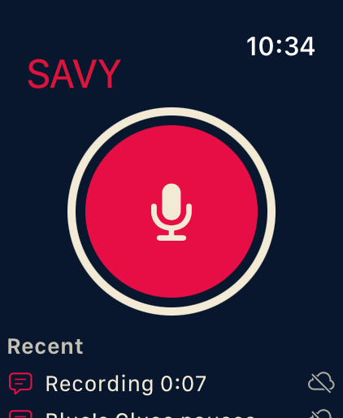
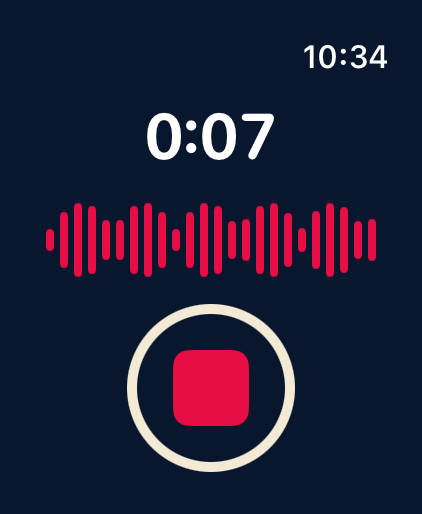
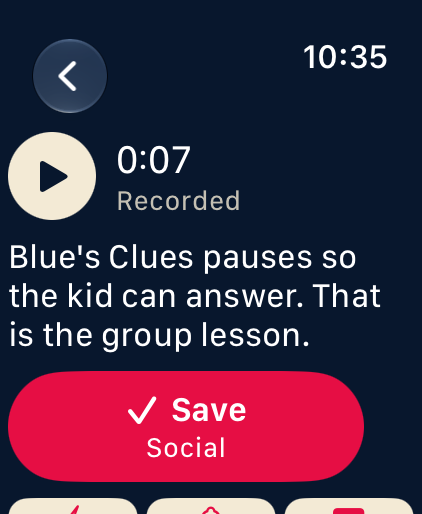
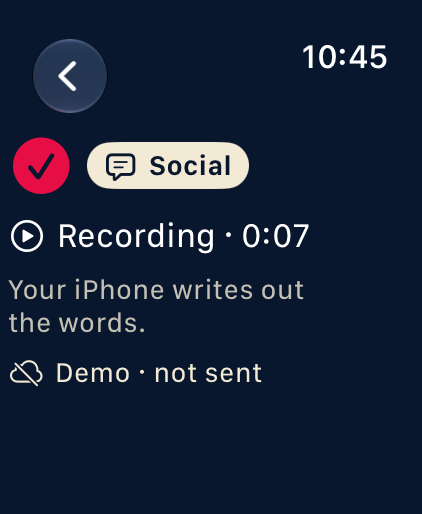
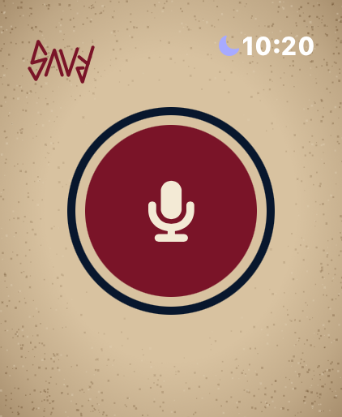

# SAVY Watch — November 20, 2026

Adam: “Okay, we're going to build an Apple Watch app for the SAVY app. I put a lot of the details in this document and I was talking to Gemini when I did it.”

The document is “SAVY On Your Wrist Without Breaking Your Stride”. Its plan: one press of the orange Action Button, or a Siri phrase, captures a voice note into Action, Reminder, Calendar Event or Staged Social Post. The Watch saves it on the wrist first, shows the exact words as proof, and the iPhone and Mac do the processing after the run. Its rule, from Adam’s note The Shift: “The app isn't a capture tool for the moment of action. It's a PROCESSING tool for after the action is taken.”

Adam, Nov 20, while this was being built: “I'm gonna put the same type of iPhone Apple Watch app on for three or four of my other apps and it's gonna have almost identical functionality”. See [Reusing this for the other apps](#reusing-this-for-the-other-apps).

## What is built

### One big button — Adam, Nov 20, after seeing the first screens

Adam: “I was thinking about it having a face just like the voice memos where it's one large button that I can press. The idea here is to reduce friction, so if I'm reducing friction, I just need one button to press. I pressed the button, I record it, and then after it's recorded, then there can be some selections. It could just be, you know, save and make sure it saves, or it could be choosing different options if it's an action or something like that, but it's really a capture surface is what it is. The only other thing I'd really like besides recording it is being able to examine what it recorded because sometimes my diction can be often it might change CODEX to KODAK or something like that.”

He then chose two things:
- **Where to check the words:** “On iPhone, with audio”.
- **Where a plain Save goes:** “Social (Generalization)”.

This replaces the first build's four doors with Watch dictation.

Adam, next: “let's just assume that I have my phone with me, so if I don't have my phone with me then I won't be able to look at the text. If I do, then the phone should be able to intervene or show me the text. It could activate that way. There's gonna be situations where I don't have my phone with me, but rare, and if my phone's not actually with me, it's 10 feet away. Like it's within Bluetooth range”.

So the nearby iPhone steps in:
1. Right after a recording stops, the Watch sends it to the iPhone in live messages. A live message wakes SAVY on the iPhone in the background.
2. The iPhone writes out the words and sends them back.
3. The review screen shows “Your iPhone is writing out the words…”, then the words, and any day or hour it heard.

When the iPhone is out of reach, the words are written out later, from iCloud.

| Plan item | Built |
|---|---|
| Watch target inside `SAVY.xcodeproj` | `SAVYWatch` (watchOS 11+, bundle `com.adamblair.savy.watchkitapp`), display name SAVY |
| Complication and Smart Stack | `SAVYWatchWidgets`: circular, corner, rectangular and inline; a tap opens SAVY |
| One big button | Crimson record button. One press records, with a timer and moving level bars; one press stops |
| After recording | Play it back. **Save** files it as Social (the first Generalization question). One tap on Action, Reminder or Calendar files it as that instead. Delete or Again are below. Leaving the screen saves it, so a recording is never lost |
| Proof it saved | A tap on the wrist, the type, the recording, and “Saved on Watch · sending”, then “· in iCloud” |
| Action Button | The “Capture” shortcut opens SAVY already recording, so the orange button is the one press |
| Four Siri phrases | “Log an action in SAVY”, “Add a reminder in SAVY”, “Create a calendar event in SAVY”, “Stage a social post in SAVY”. Siri asks for the words, saves them and reads them back |
| Local first | Every recording is written to the Watch the moment it stops. Waiting captures send when SAVY opens and when watchOS wakes it to retry |
| Checking the words | On the wrist: the nearby iPhone writes out the words a few seconds after you stop, and they show on the review screen. On the iPhone or Mac: the words in the entry, with a “Watch recording” play row at the top to hear what was actually said. The recognizer gets Adam's terms (Codex, Claude, SAVY, Generalization and more) as hints. A fix list (`corrections`: “Kodak” → “Codex”) is applied last |
| Sync | iCloud, in SAVY's existing container `iCloud.com.adamblair.harness`, zone `SAVYWatchInboxV1` |

### How each capture lands on the iPhone and Mac

When SAVY opens or refreshes, each capture becomes a normal entry through `ReminderStore.save`, the same path the entry form’s Save uses. It then syncs to the other devices like any other entry.
- For a recording, this device first writes out the words. If Speech Recognition is off or nothing was heard, the entry still arrives with the recording, under SAVY's generic name (“New Social”). The form replaces that name once Adam types.
- Only one device makes the entry: the first iPhone or Mac claims the capture in iCloud. Every device keeps its own copy of the recording, and the claiming device deletes the capture from iCloud after two weeks.

| Door | Entry | Where the words go | Day or hour |
|---|---|---|---|
| Action | Action | What do I want? | Not read |
| Reminder | Reminder | What do I want? | “tomorrow at 3 PM” becomes the Schedule, alert at start. A day with no hour starts at 9:00, SAVY’s existing default |
| Calendar | Event | What do I want? | Same, one hour long; a day with no hour is all-day with no alert. No Apple Calendar is chosen, so nothing is written to Calendar until Adam picks one |
| Social | Social, Generalization theme | The first question, “What shining example caught my attention?” | Not read |

The Social door follows Adam’s own words in the YouTube system doc: “Common scenario is that I am out for a run and have an idea hit me.” He answers only the first question, and the other three wait for him on the iPhone or Mac. Nothing is added that he did not say: no tags, no notes, no generic name.

## Where the build differs from the plan, and why

1. **The Watch records; the iPhone writes out the words.** The plan made a live transcript on the Watch. Apple’s speech-to-text frameworks, `SFSpeechRecognizer` and `SpeechAnalyzer`, are not available on watchOS. Watch dictation always opens Apple’s dictation screen first, so it cannot start on one press. Adam chose one press and audio, with the words checked on the iPhone beside the recording.
2. **No AWS or Supabase upload.** Adam cancelled AWS on Oct 12 (“I cancelled AWS last night”). SAVY now syncs through iCloud, so the Watch uses iCloud too.
3. **The Watch-to-iPhone link only writes out the words.** Entries still come from iCloud, once. The link was added on Nov 20 after Adam said the iPhone should “show me the text”: the Watch sends the recording to the nearby iPhone, and the iPhone sends the words back to the wrist. It never makes the entry, so nothing is doubled.
4. **The Watch writes to its own iCloud zone, `SAVYWatchInboxV1`.** SAVY’s entries live in `SAVYEntriesV1`, and an unreadable record there stops entry sync until it is repaired. The Watch never writes there, so a Watch bug cannot stall the iPhone and Mac. The iPhone and Mac import only after iCloud sync has confirmed the signed-in owner. Each import is saved locally before the capture is removed from iCloud, and a ledger keeps a deleted entry from coming back.
5. **StoreKit 2 is not built.** The plan ties it to selling SAVY. Nothing needs unlocking for Adam’s own use yet.
6. **The Watch app rides inside the iPhone app, since Nov 21.** It was first installed on its own by running the `SAVYWatch` scheme. On Adam's devices that left the two apps unable to see each other as a pair (WatchConnectivity 7018), so the words never reached the wrist. `watchkit.py embed` added an Embed Watch Content step to the iPhone target, for iOS only, so the Mac build is unchanged. A paired-simulator run on his Mac proved it: with the Watch app inside, the words came back in 3.5 seconds; with it taken out, the same 7018.

## Status

- Written in cloud sessions with no Xcode and no access to Adam’s Macs (no Tailscale secrets and no Remote Control folder were available). A session on his Mac Studio signed and installed the Watch app on Nov 20.
- Compile check: `.github/workflows/watch-build.yml` runs on the `xcode-27` GitHub runner. It builds `SAVYWatch` for the watchOS Simulator and `SAVY` for the iOS Simulator, and runs `SAVYWatchCaptureTests` (values only: no store, iCloud or Watch). It also screenshots the Watch app. Results per commit are under [CI results](#ci-results).
- On his Apple Watch Ultra 3 since Nov 20, where it opens. Adam, Nov 21: “The Apple Watch SAVY app works and doesn't work. It needs a lot of testing.” No real capture has yet been followed from the wrist to an entry. See [Testing on the Watch and iPhone](#testing-on-the-watch-and-iphone). Adam’s own use is the acceptance check.

### CI results

- `bc7b773`: the Watch app and complication built for the watchOS Simulator with no errors.
- `d2eff53` (runner Xcode 26.6, Swift 6.3.3): the Watch app built, installed and ran on an Apple Watch Ultra 3 simulator. The iPhone build hit a Swift compiler crash in IRGen on SAVY's existing `ReminderScheduleView.swift` (a `ReminderAlert` thunk). This PR does not touch that file.
- `945b2e5` (runner `xcode-27`, Xcode 27.2, the Xcode Adam builds with): the Watch app built and its screenshots below were taken. The iPhone app built with no crash, and all 11 `SAVYWatchCaptureTests` passed. The job was marked failed only because the check looked for “TEST SUCCEEDED”, and Xcode 27 prints “TEST EXECUTE SUCCEEDED”. The check is fixed in the next commit.
- `744fc05` (runner `xcode-27`, Xcode 27.2): every check passed. The Watch app built and its screenshots were taken, the iPhone app built, and all 11 `SAVYWatchCaptureTests` passed.
- `3ad3920` (one big button, with the nearby iPhone writing out the words): every check passed on Xcode 27.2. The Watch app built and the four screens below were taken, the iPhone app built, and all 19 `SAVYWatchCaptureTests` passed.
- `b445f22`: every check passed on Xcode 27.2. The saved screen's navy now fills the screen.
- `8bbc23e` (the sand, maroon and navy look, signed and installed on his Watch from his Mac): every check passed on Xcode 27.2. The Watch app built and its four screens were taken in the new look, the iPhone app built, and all 19 `SAVYWatchCaptureTests` passed.

### Screens, from the real app

Adam, on seeing these four screens in their first navy look: “Yep,that looks great”. Later on Nov 20 he chose the look shown here, looking at his own Watch: sand with darker, grainy edges, a maroon button in a navy ring, and “SAVY” in the icon's lettering. Of the sand, maroon, ring and lettering: “perfect”. Of the edges: “Yes, keep them”.

These are an Apple Watch Series 11 (46mm) simulator on Xcode 27.2 on his Mac, launched with `-WatchCaptureDemo` (Debug only). The recording is silent and the words are demo words; nothing was sent anywhere. On the review screen, the words stand in for what the nearby iPhone sends back.

| Big button | Recording | Review: words back from the iPhone | Saved |
|---|---|---|---|
|  |  |  |  |

On the review screen, Action, Reminder and Calendar sit just below Save; turn the Digital Crown to reach them. A real capture shows “Saved on Watch · sending”, then “· in iCloud”, in place of “Demo · not sent”.

The same build on his Apple Watch Ultra 3, Nov 20, 10:20 PM:



## Install and set up (needs Adam’s Mac, Watch and iPhone)

1. On the Mac, open `SAVY.xcodeproj`, choose the `SAVYWatch` scheme and the Ultra 3 as the destination, and Run. Automatic signing registers `com.adamblair.savy.watchkitapp` and `com.adamblair.savy.watchkitapp.widgets`. If signing reports iCloud, open Signing & Capabilities for SAVYWatch and tick the `iCloud.com.adamblair.harness` container.
2. Install the iPhone and Mac apps from a build that has this branch in it. They are the side that writes out the words and turns captures into entries. His installed apps are normally built from `claude/ai-communication-interface-b714f9` (Send to AI) with `main` merged in, and that branch has no Watch code. Merge this branch into the one being installed first; a trial merge of all three on Nov 21 conflicted only in `AGENTS.md`.
3. Action Button: in Settings on the Watch, choose Action Button, then Action, then Shortcut, and pick a SAVY shortcut. Apple’s Ultra guide gives this path.
4. Complication: edit the watch face and add SAVY Capture.
5. First test: see [Testing on the Watch and iPhone](#testing-on-the-watch-and-iphone).

## Testing on the Watch and iPhone

Adam, Nov 21: “The Apple Watch SAVY app works and doesn't work. It needs a lot of testing. Help me figure out how to test it or test it yourself. How do we connect and make sure that it works properly”

### How the pieces connect

A capture has to do four things. The first happens on the Watch alone. The other three need the iPhone app.

| # | What must happen | Where | It needs |
|---|---|---|---|
| 1 | Recorded and kept | Watch | The microphone allowed for SAVY on the Watch |
| 2 | Words back on the wrist | Watch to iPhone and back, over Bluetooth | The iPhone nearby, running a SAVY that has the Watch code, with Speech Recognition allowed |
| 3 | In iCloud | Watch to iCloud | The Watch signed in to iCloud, and the Watch build allowed to use `iCloud.com.adamblair.harness` |
| 4 | Entry in SAVY | iCloud to iPhone or Mac | SAVY opened on an iPhone or Mac that has the Watch code, with its own iCloud sync in a ready state |

### What reading the code found, Nov 21

Item 1 was read from his devices. Items 2 to 4 come from reading the code; each is a way the app could work and not work.

1. **The iPhone had the Watch code, and had lost Send to AI.** A cloud session first suspected the iPhone app had no Watch code. The session on his Mac Studio read the devices and found the opposite: the iPhone's SAVY was installed on Nov 20 from this branch at `6eff101`, and it had already made one entry from a Watch capture. That install replaced the Send to AI build, so the iPhone had no Send to AI from Nov 20. The iPhone app must be built from a merge of this branch and `claude/ai-communication-interface-b714f9`.
2. **Three callbacks could stop the Watch app.** The project builds in Swift 6 mode. Three closures written inside main-thread types were handed to the system as callbacks: the error handler for a recording sent to the iPhone, the background retry, and the microphone permission. If the system calls one from another thread, the app stops. The first fires exactly when the iPhone does not answer. All three are fixed (`@Sendable`, or the `async` form).
3. **A recording the system cut short was reported as ten minutes long.** The length now comes from the file itself.
4. **Every failure was silent.** “Sends when online” covered every iCloud failure, including ones that waiting never fixes. An import that waited on SAVY's own sync, a missing Speech Recognition permission, and an iPhone that never answered all left no trace.

### The trail

Each app now writes one line per step to `Application Support/SAVYWatch/trail.jsonl` in its own container: a time, the step, whether it worked, the capture's id, and a state, a count or an error code. It never holds the words or the recording. The file keeps its last few hundred lines. The same lines go to the system log under the category `WatchCaptureTrail`.

The Watch's status line also says more: “iCloud refused it (code 10)” or “iCloud storage is full”, where it used to say “sends when online” for everything.

### The test

1. On the Mac, build the iPhone app from a branch with all three in it (this branch, `main`, Send to AI) and install it. Install the Watch app from this branch again. The usual checks before touching the iPhone apply: no open editor with unsaved writing, and saved files compared before and after.
2. Adam opens SAVY on the iPhone once, and allows Speech Recognition if it asks.
3. Adam makes three captures on the Watch, saying anything real, one for each condition:
   - iPhone unlocked with SAVY open;
   - iPhone locked, in a pocket;
   - iPhone's Bluetooth off, or the iPhone left in another room.
4. Adam opens SAVY on the iPhone and looks for three new Social entries, each with its “Watch recording” row.
5. On the Mac, with the iPhone connected:

   ```bash
   python3 .cursor/skills/watch-capture/scripts/watchtrail.py pull --config watch-capture.json
   ```

   It copies both trail files off the devices and prints, for each capture, the four results and what to do about the first one that stopped. The device-copy part was written without a Mac and has not run; if it fails, copy `Library/Application Support/SAVYWatch/trail.jsonl` out of each app's container by hand and run `watchtrail.py read` on the two files.

What each condition answers:

| Capture | Words back on the wrist | Answers |
|---|---|---|
| SAVY open on the iPhone | Expected within seconds | Does the link work at all? |
| iPhone locked in a pocket | Unknown | Can iOS write out words while SAVY is in the background? If not, the words arrive when SAVY is next opened. |
| iPhone out of reach | Not expected | Does the capture still reach iCloud and become an entry later? |

For any capture, the `record.stop` line compares the recording's length with the time between the two presses. A recording that stopped when the wrist dropped shows there.

### Test in simulators first

Adam, Nov 21: “Do 1000% of your tests on a fucking simulator. That's what you should do. It should work perfectly on a goddamn fucking simulator. Instead of sitting here holding me to this fucking desk.”

`scripts/sim_link_test.py` in the kit does that for the Watch-to-iPhone link, on GitHub or on his Mac, with no device and no person:

```bash
python3 .cursor/skills/watch-capture/scripts/sim_link_test.py --config watch-capture.json --app <path to the simulator build of SAVY.app>
```

It pairs an iPhone and a Watch simulator, installs both apps, and has the Watch send a spoken recording across the live link. Two hooks make that possible, both compiled for the simulator only: the Watch sends a recording the test placed, and the iPhone answers with set words. It reads both trails and passes only when the words come back with the Watch app inside the iPhone app. It also runs the stand-alone setup, which must fail the way his devices did.

A simulator cannot use his iCloud account, the real microphone or Bluetooth. Recording, iCloud and the entry on the iPhone were shown on his own devices on Nov 21. GitHub also builds both apps, runs the unit tests and screenshots the Watch screens on every push.

## Open questions for Adam

1. Does a recording keep going when your wrist drops mid-run? It should, with the audio background mode, but it has to be tried on the Ultra 3.
2. Do the words come back to the wrist with the iPhone in your pocket? This relies on iOS letting SAVY write out words in the background. Older reports say the older recognizer can't. SAVY tries iOS 26's on-device SpeechAnalyzer first. If the words don't come back in your pocket, they still arrive on the iPhone when SAVY opens.
3. Should the complication also open straight into recording, like the Action Button?
4. Are there more words it keeps mishearing? Add them to `vocabulary` (hints) or `corrections` (fixes) in `watch-capture.json`.

## Reusing this for the other apps

Adam: “save the watch workflow so I can reuse it”. The workflow is saved as the **watch capture kit**, a skill at `.cursor/skills/watch-capture/`. Its procedure, decisions and gotchas are in `SKILL.md` there. A Claude Code pointer is at `.claude/skills/watch-capture/`, and the kit is listed in the Skills Hub.

- One file per app, `watch-capture.json`, holds the app's name, iCloud inbox, doors, Siri phrases, colors and Xcode settings. SAVY's is at the repo root and is the worked example.
- `watchkit.py files` writes the Watch code and settings. `watchkit.py wire` adds the targets to the Xcode project. Per app, only the destination file (where the words go in that app's entries) and its tests are written by hand.
- SAVY itself is built from the kit. SAVY's own files are generated from its config, and its project was re-wired by `watchkit.py wire` from the pre-Watch project file. CI fails if SAVY and the kit drift apart.

Lessons from this build, also in the skill:

- Check what watchOS supports before designing. The plan assumed on-Watch transcription, which watchOS does not have.
- Give each app its own inbox zone in the shared container, and keep the Watch out of the app's main sync zone.
- The first `wire` run put files in the wrong build phase. It now finds each project object by its definition, and `check` prints every phase.

Better next, also in the skill:

- **One Action Button.** An Ultra has one Action Button, and only one shortcut can own it. One suite capture app could serve every app, with each door sending its capture to the right app's inbox.
- **A Swift package** for the shared files, so a fix reaches every app at once.
