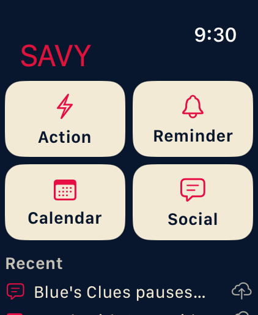
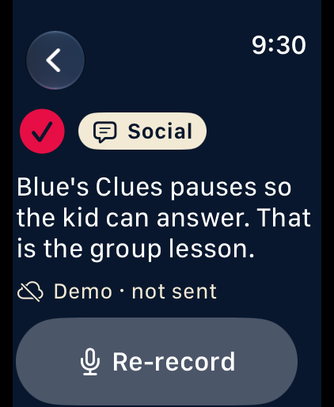
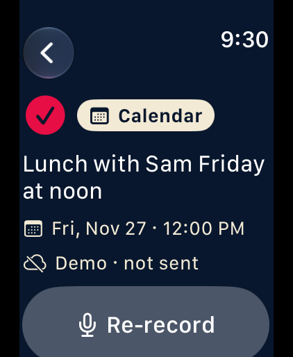

# SAVY Watch — November 20, 2026

Adam: “Okay, we're going to build an Apple Watch app for the SAVY app. I put a lot of the details in this document and I was talking to Gemini when I did it.”

The document is “SAVY On Your Wrist Without Breaking Your Stride”. Its plan: one press of the orange Action Button, or a Siri phrase, captures a voice note into Action, Reminder, Calendar Event or Staged Social Post. The Watch saves it on the wrist first, shows the exact words as proof, and the iPhone and Mac do the processing after the run. Its rule, from Adam’s note The Shift: “The app isn't a capture tool for the moment of action. It's a PROCESSING tool for after the action is taken.”

Adam, Nov 20, while this was being built: “I'm gonna put the same type of iPhone Apple Watch app on for three or four of my other apps and it's gonna have almost identical functionality”. See [Reusing this for the other apps](#reusing-this-for-the-other-apps).

## What is built

### One big button — Adam, Nov 20, after seeing the first screens

Adam: “I was thinking about it having a face just like the voice memos where it's one large button that I can press. The idea here is to reduce friction, so if I'm reducing friction, I just need one button to press. I pressed the button, I record it, and then after it's recorded, then there can be some selections. It could just be, you know, save and make sure it saves, or it could be choosing different options if it's an action or something like that, but it's really a capture surface is what it is. The only other thing I'd really like besides recording it is being able to examine what it recorded because sometimes my diction can be often it might change CODEX to KODAK or something like that.”

He then chose two things:
- **Where to check the words:** “On iPhone, with audio”.
- **Where a plain Save goes:** “Social (Generalization)”.

This replaces the first build's four doors with Watch dictation.

| Plan item | Built |
|---|---|
| Watch target inside `SAVY.xcodeproj` | `SAVYWatch` (watchOS 11+, bundle `com.adamblair.savy.watchkitapp`), display name SAVY |
| Complication and Smart Stack | `SAVYWatchWidgets`: circular, corner, rectangular and inline; a tap opens SAVY |
| One big button | Crimson record button. One press records, with a timer and moving level bars; one press stops |
| After recording | Play it back. **Save** files it as Social (the first Generalization question). One tap on Action, Reminder or Calendar files it as that instead. Delete or Again are below. Leaving the screen saves it, so a recording is never lost |
| Proof it saved | A tap on the wrist, the type, the recording, and “Saved on Watch · sending”, then “· in iCloud” |
| Action Button | The “Capture” shortcut opens SAVY already recording, so the orange button is the one press |
| Four Siri phrases | “Log an action in SAVY”, “Add a reminder in SAVY”, “Create a calendar event in SAVY”, “Stage a social post in SAVY”. Siri asks for the words, saves them and reads them back |
| Local first | Every recording is written to the Watch the moment it stops. Waiting captures send when SAVY opens and when watchOS wakes it to retry |
| Checking the words | The iPhone or Mac writes out the words, with Adam's own terms (Codex, Claude, SAVY, Generalization and more) as hints to the recognizer. The recording stays beside the words: a “Watch recording” play row at the top of the entry |
| Sync | iCloud, in SAVY's existing container `iCloud.com.adamblair.harness`, zone `SAVYWatchInboxV1` |

### How each capture lands on the iPhone and Mac

When SAVY opens or refreshes, each capture becomes a normal entry through `ReminderStore.save`, the same path the entry form’s Save uses. It then syncs to the other devices like any other entry.
- For a recording, this device first writes out the words. If Speech Recognition is off or nothing was heard, the entry still arrives with the recording, under SAVY's generic name (“New Social”). The form replaces that name once Adam types.
- Only one device makes the entry: the first iPhone or Mac claims the capture in iCloud. Every device keeps its own copy of the recording, and the claiming device deletes the capture from iCloud after two weeks.

| Door | Entry | Where the words go | Day or hour |
|---|---|---|---|
| Action | Action | What do I want? | Not read |
| Reminder | Reminder | What do I want? | “tomorrow at 3 PM” becomes the Schedule, alert at start. A day with no hour starts at 9:00, SAVY’s existing default |
| Calendar | Event | What do I want? | Same, one hour long; a day with no hour is all-day with no alert. No Apple Calendar is chosen, so nothing is written to Calendar until Adam picks one |
| Social | Social, Generalization theme | The first question, “What shining example caught my attention?” | Not read |

The Social door follows Adam’s own words in the YouTube system doc: “Common scenario is that I am out for a run and have an idea hit me.” He answers only the first question, and the other three wait for him on the iPhone or Mac. Nothing is added that he did not say: no tags, no notes, no generic name.

## Where the build differs from the plan, and why

1. **The Watch records; the iPhone writes out the words.** The plan made a live transcript on the Watch. Apple’s speech-to-text frameworks, `SFSpeechRecognizer` and `SpeechAnalyzer`, are not available on watchOS. Watch dictation always opens Apple’s dictation screen first, so it cannot start on one press. Adam chose one press and audio, with the words checked on the iPhone beside the recording.
2. **No AWS or Supabase upload.** Adam cancelled AWS on Oct 12 (“I cancelled AWS last night”). SAVY now syncs through iCloud, so the Watch uses iCloud too.
3. **No separate WatchConnectivity path.** When the iPhone is in a pocket, the Watch’s iCloud traffic already goes through it. One path has fewer ways to fail. It can be added if a capture is ever slow to appear.
4. **The Watch writes to its own iCloud zone, `SAVYWatchInboxV1`.** SAVY’s entries live in `SAVYEntriesV1`, and an unreadable record there stops entry sync until it is repaired. The Watch never writes there, so a Watch bug cannot stall the iPhone and Mac. The iPhone and Mac import only after iCloud sync has confirmed the signed-in owner. Each import is saved locally before the capture is removed from iCloud, and a ledger keeps a deleted entry from coming back.
5. **StoreKit 2 is not built.** The plan ties it to selling SAVY. Nothing needs unlocking for Adam’s own use yet.
6. **The Watch app is not embedded in the iPhone app yet.** Install it by running the `SAVYWatch` scheme. The iPhone and Mac build settings are unchanged apart from two new source files. Embedding is needed later for TestFlight or the App Store.

## Status

- Written in a cloud session with no Xcode and no access to Adam’s Macs (no Tailscale secrets and no Remote Control folder were available).
- Compile check: `.github/workflows/watch-build.yml` runs on the `xcode-27` GitHub runner. It builds `SAVYWatch` for the watchOS Simulator and `SAVY` for the iOS Simulator, and runs `SAVYWatchCaptureTests` (values only: no store, iCloud or Watch). It also screenshots the Watch app. Results per commit are under [CI results](#ci-results).
- Not yet done: signing, installing on the Watch, any on-device check, and the first real capture going from wrist to iPhone. Adam’s own use is the acceptance check.

### CI results

- `bc7b773`: the Watch app and complication built for the watchOS Simulator with no errors.
- `d2eff53` (runner Xcode 26.6, Swift 6.3.3): the Watch app built, installed and ran on an Apple Watch Ultra 3 simulator. The iPhone build hit a Swift compiler crash in IRGen on SAVY's existing `ReminderScheduleView.swift` (a `ReminderAlert` thunk). This PR does not touch that file.
- `945b2e5` (runner `xcode-27`, Xcode 27.2, the Xcode Adam builds with): the Watch app built and its screenshots below were taken. The iPhone app built with no crash, and all 11 `SAVYWatchCaptureTests` passed. The job was marked failed only because the check looked for “TEST SUCCEEDED”, and Xcode 27 prints “TEST EXECUTE SUCCEEDED”. The check is fixed in the next commit.
- `744fc05` (runner `xcode-27`, Xcode 27.2): every check passed. The Watch app built and its screenshots were taken, the iPhone app built, and all 11 `SAVYWatchCaptureTests` passed.

### Screens, from the real app

These are an Apple Watch Ultra 3 simulator on Xcode 27.2, launched with `-WatchCaptureDemo` (Debug only). The words are demo words, never sent anywhere.

| Doors | Proof: Social | Proof: Calendar |
|---|---|---|
|  |  |  |

The Calendar proof shows “Lunch with Sam Friday at noon”, said on Friday Nov 20, read as Fri, Nov 27 · 12:00 PM. A real capture shows “Saved on Watch · sending”, then “Saved on Watch · in iCloud”, in place of “Demo · not sent”.

## Install and set up (needs Adam’s Mac, Watch and iPhone)

1. On the Mac, open `SAVY.xcodeproj`, choose the `SAVYWatch` scheme and the Ultra 3 as the destination, and Run. Automatic signing registers `com.adamblair.savy.watchkitapp` and `com.adamblair.savy.watchkitapp.widgets`. If signing reports iCloud, open Signing & Capabilities for SAVYWatch and tick the `iCloud.com.adamblair.harness` container.
2. Install the iPhone and Mac apps from this branch too. They are the side that turns captures into entries.
3. Action Button: in Settings on the Watch, choose Action Button, then Action, then Shortcut, and pick a SAVY shortcut. Apple’s Ultra guide gives this path.
4. Complication: edit the watch face and add SAVY Capture.
5. First test: tap Action, say a sentence, and check the words on the proof screen. Then open SAVY on the iPhone and find the entry in Actions.

## Open questions for Adam

1. Does a recording keep going when your wrist drops mid-run? It should, with the audio background mode, but it has to be tried on the Ultra 3.
2. Should the complication also open straight into recording, like the Action Button?
3. Are there more words the iPhone keeps mishearing? Add them to `vocabulary` in `watch-capture.json`.

## Reusing this for the other apps

Adam: “save the watch workflow so I can reuse it”. The workflow is saved as the **watch capture kit**, a skill at `.cursor/skills/watch-capture/`. Its procedure, decisions and gotchas are in `SKILL.md` there. A Claude Code pointer is at `.claude/skills/watch-capture/`, and the kit is listed in the Skills Hub.

- One file per app, `watch-capture.json`, holds the app's name, iCloud inbox, doors, Siri phrases, colors and Xcode settings. SAVY's is at the repo root and is the worked example.
- `watchkit.py files` writes the Watch code and settings. `watchkit.py wire` adds the targets to the Xcode project. Per app, only the destination file (where the words go in that app's entries) and its tests are written by hand.
- SAVY itself is built from the kit. SAVY's own files are generated from its config, and its project was re-wired by `watchkit.py wire` from the pre-Watch project file. CI fails if SAVY and the kit drift apart.

Lessons from this build, also in the skill:

- Check what watchOS supports before designing. The plan assumed on-Watch transcription, which watchOS does not have.
- Give each app its own inbox zone in the shared container, and keep the Watch out of the app's main sync zone.
- The first `wire` run put files in the wrong build phase. It now finds each project object by its definition, and `check` prints every phase.

Better next, also in the skill:

- **One Action Button.** An Ultra has one Action Button, and only one shortcut can own it. One suite capture app could serve every app, with each door sending its capture to the right app's inbox.
- **A Swift package** for the shared files, so a fix reaches every app at once.
